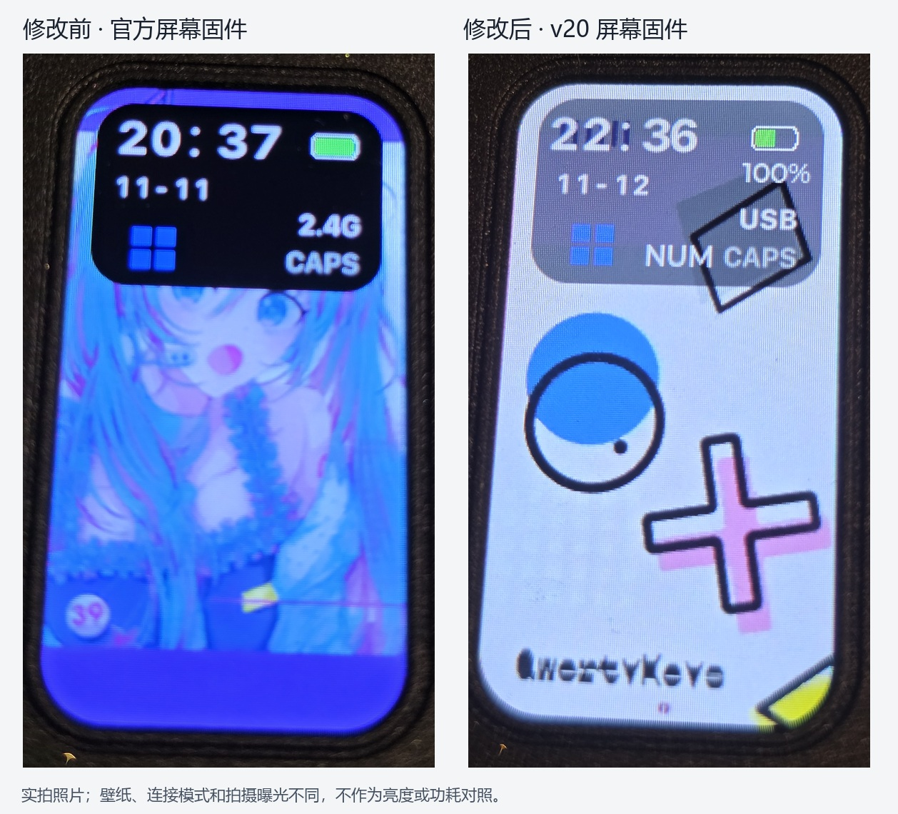
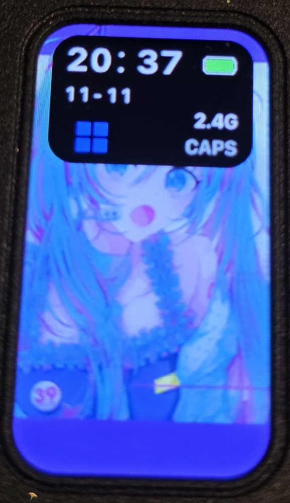
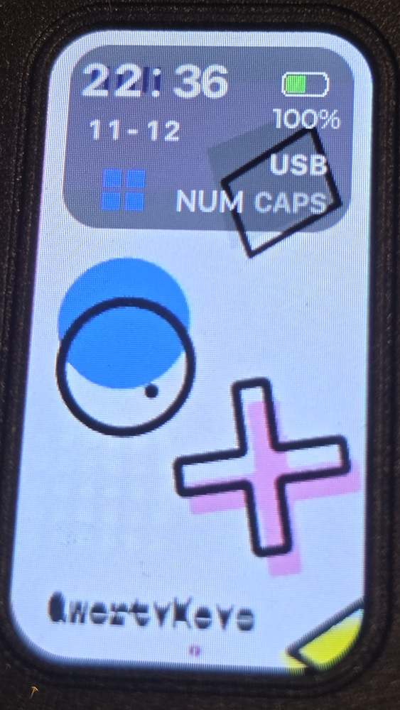

# QK100 Mk2 魔改固件与 Windows 刷写工具（非官方）

## 项目内容

本项目提供 QK100 Mk2 的两个独立魔改固件，以及 Windows x64 桌面刷写应用。主控修改版基于官方 v137，屏幕修改版基于官方 v120。应用使用官方主控 IAP 和屏幕 OTA 升级协议，内置官方固件，方便回退。

这是非官方项目，仅适用于这里核对过的 QK100 Mk2 型号。请从本仓库的 [Releases](https://github.com/a2333c/QK100-Mk2-Modded-Firmware/releases) 下载 `QK100-Firmware-Updater-1.0.3.exe`。应用已经内置下表中的固件和图包，无需另行下载才能刷写。

## 屏幕修改前后



设备实拍：左图为修改前，右图为修改后。

| 修改前 | 修改后 |
| --- | --- |
|  |  |


## 两个固件改了什么

### 主控 v137：灯组开关保持亮度

`main-v137-nobrightfloor.bin` 取消了 4 处开灯时自动抬高亮度的写入。轴灯和 Logo 灯组切换时保留已设置的亮度，不再被这些亮度下限覆盖。若亮度已经设为 0，开灯后仍可能看起来不亮，需要手动提高亮度。

这个补丁修改了 8 字节代码及 4 字节校验值。

### 屏幕 v20：显示布局和状态信息

`screen-v20.bin` 增加数字电量百分比，调整状态框与日期背景的透明度。时间左移并保留边距，小时、冒号和分钟的间隔按界面分别修正。

NUM 状态显示在 CAPS 旁边，采用与 CAPS 相同的开启、关闭颜色值，并修正字号、笔画和位置。NUM 只出现在对应界面，避免在其他屏幕模式中冒出。NUM 字体内置在屏幕程序中。

屏幕程序仍报告官方版本字段 `0x0120`。请用文件 SHA256 确认修改版，不能只看设备报告的版本号。

详细补丁和坐标见 [固件改动说明](docs/firmware-changes.md)。

## 要刷什么

两个修改版可以独立使用，按你需要的功能选择。

| 目的 | 应用中选择 | 是否需要图包 |
| --- | --- | --- |
| 电量百分比、NUM、时间与日期布局 | 屏幕：修改版 | 不需要 |
| 灯组切换时保持设置亮度 | 主控：修改版 v137 · 灯组开关保持亮度 | 不需要 |
| 资源背景半透明样式 | 图片：半透明 alpha128 图包（可选） | 需要 |
| 恢复官方主控行为 | 主控：官方 v137 | 不需要 |
| 恢复官方屏幕程序 | 屏幕：官方 v120 | 通常不需要 |
| 同时恢复官方屏幕资源 | 屏幕：官方 v120；图片：官方 v120 图包 | 需要刷官方图包 |

**v20 可以单独刷入，无需图包。** alpha128 图包只调整两个背景资源的透明度，属于可选样式。已经刷过且显示正常时，无需重复刷写。

应用默认预选官方版本。要使用修改版，请主动切换对应下拉框。

## 刷写准备

使用 Windows x64，接好 USB，并把键盘切到有线模式。关闭正在连接键盘的官方驱动网页或其他升级应用。保持稳定供电，刷写期间不要拔线、关机或结束应用。

点击“写入固件”或“写入图片包”开始升级。应用会先校验文件哈希和兼容性。

### 刷主控

1. 在主控下拉框选择“修改版 v137 · 灯组开关保持亮度”。也可先点“检测有线主控”，确认升级接口能打开。
2. 点“1. 让键盘进入 IAP 模式”，选择 QK100 Mk2 有线主控升级接口。
3. 键盘会断开并重新枚举。点“2. 连接 IAP 设备”，选择新出现的 IAP 设备。
4. 点“3. 写入固件”，等待应答检查及主控重新连接完成。检查键盘输入和灯组切换。

普通主控标识为 `36B0:3059`，IAP 标识为 `36B0:33FF`。如果键盘已经处于 IAP，可以选择固件后直接从第 3 步连接 IAP。更换预选或本地文件后，应用会重新校验文件。

### 刷屏幕 v20

1. 在屏幕下拉框选择“修改版 v20”。
2. 点“连接屏幕”，先选择普通 QK100 Mk2 键盘。应用核对状态并启用屏幕 USB 接口。
3. 按钮变为“选择 LCD 屏幕”后，再点一次，选择 `QK100 Mk2 LCD · 1919:1919`。第二次点击是新的设备授权操作，必须完成。
4. 等待屏幕版本、分辨率和主题信息核对通过，再点屏幕区域的“写入固件”。
5. 等待最终应答、屏幕重启及通信检查完成。查看实体屏幕，确认普通界面、日期、电量、NUM/CAPS 和其他主题显示正常。

屏幕固件可以独立升级，无需先刷主控修改版。

### 刷可选图包或恢复官方资源

1. 先选好屏幕程序。使用修改界面选“修改版 v20”；恢复官方界面选“官方 v120”。
2. 连接屏幕，完成上述两次设备选择。
3. 在图片区域选择“半透明 alpha128 图包（可选）”或“官方 v120 图包”。
4. 点“写入图片包”，等待整个流程结束。

**“写入图片包”会先写图包，再写上方所选屏幕程序，最后完成升级和重启。** 图包约 11.7 MB，通常需要几分钟，中途请勿断电。

## 回退与异常处理

主控回退选择“官方 v137”，屏幕回退选择“官方 v120”，按相应刷写步骤执行。若还要恢复图片资源，在屏幕程序选官方 v120 后刷“官方 v120 图包”。只回退需要恢复的组件即可。

LCD 接口能连接时，可按上述步骤刷回官方屏幕程序。接口无法枚举时，应用无法执行回退。

遇到报错时点“导出日志”，确认设备状态后按提示重新连接。写入结果不明时，不要反复点击升级。

## 文件校验、源码和验证

全部发布文件的 SHA256 见仓库和 Release 中的 `SHA256SUMS.txt`。下载后可在 PowerShell 运行：

```powershell
Get-FileHash .\QK100-Firmware-Updater-1.0.3.exe -Algorithm SHA256
```

应用源码及构建方法见 [开发说明](docs/development.md)。36 项应用测试及 7 项打包资源核验通过，3 个修改文件从官方原件重建后逐字节一致。

本项目为非官方改版，官方固件与图包的相关权利归原权利人。
